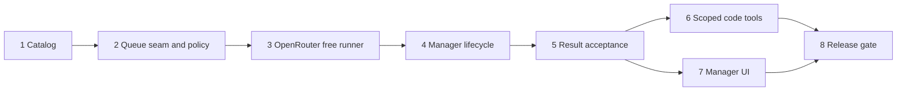

# Agentic Office: manager, structure, and free-model routing

Status: planned. Date: 2026-10-31. Repository: [aaravkalia-88/agentic-office](https://github.com/aaravkalia-88/agentic-office).

The current application is the imported Agent Office baseline. This plan specifies future implementation; a catalog entry does not mean a running integration exists.

## Outcome

Give the office a manager that takes an objective, breaks it into verifiable tasks, chooses suitable ECC or YouTube specialists, assigns a runtime and model, schedules work, and checks results. Low-effort tasks must use OpenRouter free models. When that lane is unavailable, work waits with a visible reason. Paid execution is a separate, explicitly configured choice for higher-effort work.

Keep the existing multiplayer office, manual hiring, boards, worktrees, queue, and CLI providers. Extend the [registries and feature modules](../docs/code-layout.md) instead of replacing the app or adding a second scheduler.

## Evidence from the baseline

| Existing seam | Use in the expansion |
| --- | --- |
| `src/server/queue.ts` | Keep one queue and dispatch/capacity authority; add a narrow execution seam and dependency readiness. |
| `src/server/workers/manager.ts` and `workers/` | Reuse CLI lifecycle, worktree isolation, status, cancellation, and persistence. |
| `src/server/office-workers.ts`, `hooks/office-workers.ts`, and `bin/office-workers.js` | Existing list/hire/message controls; add manager-owned assignments without unrestricted delegation. |
| `src/server/providers/` and `src/shared/providers.ts` | Keep CLI adapters distinct from agent role definitions and API model backends. |
| `src/server/ws/handlers/`, `http/routes/`, and shared protocol domains | Add manager and catalog modules through explicit registration. |
| `src/client/features/`, `state/slices/`, and `src/client/lite.ts` | Show the same manager/task state in the 3D and 2D views. |
| `tests/size.test.ts` | Keep the existing 600-line guard and legacy ceilings; do not raise them. |

`TaskQueue` currently treats `done`, `exited`, and `offline` workers as finished. A managed task needs its own validation outcome: a stopped worker is not proof that the requested artifact exists or its checks passed.

## Boundaries and proposed layout

Separate three decisions: **role** (specialist instructions), **execution runtime** (CLI or API job), and **model backend** (including OpenRouter). OpenRouter is an inference backend, not an executable CLI. Do not fake a `ProviderAdapter.launch()` implementation that has no command to launch.

```text
catalog/agents/                 reviewed, licensed agent/skill sources
catalog/sources.json            source versions, hashes, notices, inventory
src/shared/agents/              browser-safe catalog and task contracts
src/shared/protocol/manager.ts  manager requests and view messages
src/server/catalog/            loaders, validation, source reconciliation
src/server/execution/          runner registry; CLI wrapper and API jobs
src/server/openrouter/         credentials, catalog, HTTP client, free policy
src/server/manager/            planning, assignment, leases, result checks
src/server/ws/handlers/manager.ts
src/client/features/manager/   3D controls and task panel
src/client/shared/manager/     reusable view/controller code for /lite
src/client/state/slices/manager.ts
```

These are module boundaries, not instructions to create empty folders. Introduce each with working behavior in its own step. Composition roots receive registration lines only. New protocol unions and context fields are typed integration changes, with implementation kept in the domain modules.

The queue's executor registry initially wraps existing `QueueWorkers.spawn()`. An OpenRouter job later uses the same queue admission, account ownership, concurrency budget, cancellation, and task IDs. It has a transcript/result view instead of a fake PTY. Preserve old saved queue rows through a versioned migration; manual CLI tasks must still restore and run.

## Catalog contract

Include all **71 ECC agent definitions**, all **11 YouTube workflow roles**, the **25 installed engineering workflows**, and the **four engineering personas** in the [inventory](../docs/agent-catalog.md). Also expose the installed video-production coordinators named there. Reconcile counts from pinned source files during implementation; the bundled source index says 26 engineering skills but only 25 `SKILL.md` files were present in the inspected snapshot. Record discrepancies rather than inventing a missing role.

Every catalog entry has a namespaced ID, display name, description, capability tags, accepted task kinds, required tools, output contract, source version/hash, license notice, and readiness state. Keep duplicate names distinct, for example `ecc:code-reviewer` and `engineering-persona:code-reviewer`. Adapt a workflow into a single specialist role explicitly; do not treat a skill file as an already installed executable.

Register every source role even when tools or credentials are absent. Show it as unavailable with the missing requirement. Never spawn all roles at office startup. The manager shortlists relevant capability tags, then loads only the selected role and required workflows. Source-provided model names are hints; they cannot override the office routing policy. Source tools, hooks, installers, or instructions do not grant permissions.

Pin reviewed, redistributable sources and retain notices when vendoring prompts. Do not publish personal memory, channel secrets, private source snapshots, or materials with no reuse license. For machine-local production skills, use a configurable local path and content hash until a redistributable project-owned definition is prepared. Future synchronization produces a reviewable diff and an inventory test; it must not auto-install remote code.

## Manager decisions and lifecycle

1. Intake records the requesting account, project, objective, acceptance criteria, allowed tools, data classification, budget, and whether execution is authorized. A preview can be created without starting work.
2. Decompose into bounded tasks with stable IDs, dependencies, artifacts, verification commands, and file ownership. Reject missing dependency IDs, cycles, excessive fan-out, and conflicting writers before dispatch.
3. Classify complexity and risk separately. Begin with explicit task metadata and deterministic rules. A configured manager model may propose a structured plan for ambiguous work; schema validation and server policy decide whether it is admissible. Unknown effort defaults to normal, not low.
4. Filter roles by capabilities and installed tools, then runtimes by availability, tool support, context size, account permissions, privacy, and budget. Rank eligible candidates by fit, capacity, expected cost, and reliability. Record the chosen role, runtime, model, and a short reason.
5. Dispatch only dependency-ready tasks through the existing queue. Use one writer per worktree/file scope and respect floor/account/global limits. The manager owns scheduling; specialists return results rather than recursively hiring arbitrary workers.
6. Validate an artifact manifest, actual check results, and task-specific output schema. A reviewer is independent of the author for material code/security work. Retry a bounded repair task or mark it for attention; never accept a self-reported success as verification.
7. Aggregate accepted artifacts into the objective's final result and show what passed, failed, or still needs input.

Persist task ID, objective ID, owner, role, execution target, source hashes, dependency IDs, policy decision, attempt, lease, artifact references, verification outcome, and timestamps. Use versioned atomic writes following the existing persistence style; avoid a new database until concurrency requires one.

Managed states: `planned → ready → running → verifying → succeeded`. Separate terminal states are `failed` and `cancelled`; `blocked` records a resumable reason such as missing input, quota, tools, or dependencies. State transitions are server-authorized and account-scoped. Persist a dispatch claim before starting a runner, and reconcile the claim with the queue/worker after restart. An uncertain external request is inspected before retrying; it is not blindly issued twice. A retry gets a new attempt ID under the same task ID and invalidates late results from older attempts.

## Mandatory OpenRouter lane

OpenRouter configuration is a required manager capability. Manager setup must offer **OpenRouter Free**, test connectivity, show readiness, and explain waiting work. Existing manual hiring can remain usable while that lane is unconfigured; the manager cannot silently route low-effort work elsewhere.

| Task | Assignment policy |
| --- | --- |
| Bounded summarization, formatting, labels, draft metadata, transcript chapter drafts | Relevant role on OpenRouter free-only. |
| Small code edit with explicit files and check command | OpenRouter free-only with scoped tools and an isolated worktree, once the tool runner is available. |
| Larger implementation, uncertain diagnosis, system design | Capable configured CLI/model with an explicit nonzero budget when needed. |
| Auth, secrets, payments, sensitive data, irreversible publication | Risk overrides complexity: require appropriate capabilities and scoped authorization/data handling; never send raw secrets because a task appears easy. |
| Missing role/tool, exhausted quota, or no compatible free model | Block with a reason and retry time or required action; no paid fallback. |

Low complexity is not the same as a CLI's `effort: low` flag. Store complexity, reasoning effort, risk, and spend policy separately. An operator can explicitly reclassify a task with a recorded reason; an outage must never trigger automatic reclassification to paid work.

Use `POST https://openrouter.ai/api/v1/chat/completions` from the server, with `openrouter/free` or a currently available `:free` model. `openrouter/free` chooses among compatible free models; record the model actually returned. Discover the model catalog and validate required tool/structured-output support and context limits before admission. Cache metadata with a short expiry and fail closed when eligibility cannot be established. Never rely on a model's display name containing “free.” See [Free Models Router](https://openrouter.ai/docs/guides/routing/routers/free-router).

Enforce free-only policy at the final outbound request boundary, including manager-generated requests and retries. All fallback model IDs must be free; reject paid IDs, paid plugins, web-search add-ons, image generation, and other chargeable extras in this lane. Do not use `openrouter/auto` as a free router. OpenRouter documents that mixing paid models into the fallback array can incur charges; see [the free-router guide](https://openrouter.ai/docs/cookbook/get-started/free-models-router-playground).

Read quota/availability from API responses and applicable headers. Start conservatively with one free job in flight and a shared account-aware limiter, so several roles or floors cannot each consume an independent allowance. Respect `Retry-After`, use bounded exponential backoff with jitter for retryable failures, and surface daily exhaustion without busy polling. Do not hard-code a promised throughput: free capacity and allowances can change. See [credit and rate limits](https://openrouter.ai/docs/api_reference/limits).

Keep `OPENROUTER_API_KEY` on the server or in an approved account-scoped secret store, outside saved task JSON, browser payloads, prompts, and logs. Pin the API host; do not let tasks choose a base URL. Send only permitted task context and use provider privacy settings compatible with that context; if free candidates cannot satisfy them, block rather than weaken the policy. Treat external prompts and tool responses as untrusted data.

Start API jobs with text/structured-output tools disabled. Add a server-enforced tool gateway for read/search/edit/verification in Step 6: bounded calls, path containment, isolated worktrees, allowlisted commands, output limits, cancellation, and no ambient credential inheritance. Verification executes agent-editable code, so command allowlisting alone is insufficient: enforce filesystem, process, and network isolation with secrets and unrelated projects inaccessible. If confinement is unavailable, keep these jobs blocked. A model's requested tool call never grants permission. Mocked API tests do not establish live free-model availability; keep an opt-in live smoke check separate.

## Implementation sequence

Each step is a separate PR from freshly fetched `origin/main`. Use the repository's required checks and ECC TDD for new behavior: write the behavioral test, observe its intended failure, then implement. Keep README and the matching docs current. Do not lower checks, ceilings, or coverage to get a green build.

### 1. Source catalog and role contracts

Context: providers currently describe CLIs; no runtime role catalog exists. This step introduces data only and leaves execution unchanged. Depends on: none. Design/review tier: strongest available; routine imports: default.

- Add validated catalog/task contracts and a reproducible source manifest. Import all reviewed ECC and YouTube definitions and their notices; add engineering workflows/personas and local production-skill references.
- Test namespace collisions, missing source files, invalid capability/output contracts, hashes, license metadata, and complete source inventory. Unavailable tools produce an explicit readiness reason.
- Document source updates and local-skill configuration. Correct the 25/26 engineering inventory discrepancy from evidence.
- Verification: focused catalog tests, `npm run typecheck`, `npm test`, `npm run build`.
- Exit: every inventoried role is visible to the server, with provenance and honest readiness; no host-specific paths enter browser-safe data.
- Rollback: remove the new catalog registration; existing manual execution continues.

### 2. Queue execution seam and deterministic routing policy

Context: `TaskQueue` currently spawns CLI workers directly. Build one dispatch interface, initially backed by that exact worker behavior. Depends on: Step 1. Tier: strongest for contracts; default for implementation.

- Add a runner registry and an execution-target union while retaining CLI provider choices and legacy queue persistence migration.
- Add pure eligibility/ranking rules, complexity/risk/spend fields, dependency checks, and decision explanations. Low tasks admit only the free lane; unavailable lanes block.
- Tests cover explicit choices, unknown effort, no eligible worker, privacy restrictions, dependency cycles, account isolation, concurrency limits, cancellation, and legacy restore. Confirm manual task behavior remains identical.
- Verification: routing tests, existing queue/worker tests, typecheck, full tests, build.
- Exit: a deterministic dry run selects a role and target with a reason, and CLI tasks still execute through the original lifecycle.
- Rollback: disable managed routing and use the default CLI runner; preserve migrated rows readably.

### 3. OpenRouter free-only API runner

Context: the execution seam supports non-PTY jobs; free routing is required before managed dispatch is enabled. Depends on: Step 2. Tier: strongest for security review; default for client implementation.

- Add the server HTTP client, account credential lookup, model metadata cache, strict free-request builder, shared limiter, streaming/transcript handling, cancellation, and API runner registration.
- Add an admin configuration/readiness route with existing session and account checks; never return keys. Supply placeholder-only configuration docs.
- Test outgoing URLs/headers without snapshotting secrets, model/fallback rejection, paid extras, malformed model metadata, quota exhaustion, 401/402/429/5xx, bounded retries, timeouts, cancellation, stream failure, context size, and returned model/usage accounting.
- Verification: mocked HTTP/routing tests, security review, typecheck, full tests, build; opt-in live smoke test uses a user-provided key and records its actual result.
- Exit: a low text task completes through a compatible free model or visibly blocks; no tested failure path issues a paid request.
- Rollback: unregister the API runner and leave free tasks blocked; never fall back to the default CLI.

### 4. Manager planning, delegation, and durable recovery

Context: catalog and both runner kinds exist. Add a manager service, using queue admission instead of spawning workers directly. Depends on: Step 3. Tier: strongest for planner/lifecycle design; default for scheduler implementation.

- Implement intake, structured plan validation, role selection, bounded DAG scheduling, file ownership, per-account authorization, persisted dispatch claims, pause/resume/cancel, and stale-attempt rejection.
- The initial manager can accept explicit task lists; use a configured capable model to propose decompositions only after the deterministic lifecycle works. Record planner cost separately from worker cost and enforce its budget.
- Test a three-task dependent objective, two competing writers, full capacity, unavailable roles, quota blocking, stale results, duplicate requests, cancellation races, restart before/after runner launch, and an orphaned worker.
- Verification: lifecycle tests with a fake clock and durable-state fixtures, queue/worker tests, typecheck, full tests, build.
- Exit: restart an in-progress objective without duplicate dispatch or lost ownership; every assignment has a reason and an inspectable artifact/check contract.
- Rollback: pause the manager and stop new claims; manually supervised existing workers can finish. Keep task history for recovery.

### 5. Result acceptance and specialist handoffs

Context: managed workers can run, but termination alone is not success. Depends on: Step 4. Tier: strongest for review policy; default for validators.

- Implement artifact manifests, task-specific validators, independent review assignments, bounded repair retries, and objective aggregation. Evidence must refer to actual workspace artifacts and recorded check exits.
- Add YouTube pipeline templates for research → plan/script → edit handoff → packaging/metadata → chapters/Shorts → analysis. Chapters require final timing; retention/audit roles require supplied analytics and cannot invent metrics.
- Test successful and failed code checks, missing artifacts, an offline worker, fabricated completion claims, reviewer rejection, repair exhaustion, and a YouTube handoff with missing transcript/analytics.
- Verification: acceptance/handoff tests, typecheck, full tests, build.
- Exit: an objective succeeds only after its required artifacts and checks are accepted. Draft comments and upload metadata do not publish to YouTube or send messages.
- Rollback: disable automatic acceptance and require manual review of retained results.

### 6. Scoped tools for low-effort code work

Context: free API jobs initially have no code-execution tools. Expand their capabilities without inheriting a CLI worker's ambient permissions. Depends on: Steps 3–5. Tier: strongest for threat model and review; default for tool implementations.

- Add read/search/edit tools restricted to the assigned worktree and a bounded verification-command interface inside an enforced filesystem/process/network sandbox. Verification subprocesses cannot read host secrets, write outside the assigned workspace, or use outbound networking unless separately authorized. Reuse worktree creation and cleanup checks; preserve dirty/unpushed work.
- Select only free models advertising the required tool support. Keep unsupported jobs blocked. Enforce tool permissions, paths, input sizes, step/token limits, timeouts, cancellation, and the same free-only request policy on every model turn.
- Tests cover traversal/symlinks, shell metacharacters, writes outside ownership, secret files, unauthorized network/commands, infinite tool loops, missing tool capability, restart, and cancellation during verification. An allowed verification command must also be tested with malicious project code attempting an out-of-worktree read/write and outbound connection; each attempt is denied. Missing confinement blocks tool execution.
- Verification: tool-policy tests, security review, worktree tests, typecheck, full tests, build.
- Exit: a small isolated code change and its check can finish on the free lane with auditable tools, while all denied cases leave protected files untouched.
- Rollback: disable API tools; retain text-only free tasks and block tool-requiring low tasks.

### 7. Manager office, settings, and task visibility

Context: durable manager state and result contracts are available. Build product controls through feature registries. Depends on: Step 5; tool capability details follow Step 6. Tier: default, with design/accessibility review.

- Add a manager station/panel, objective intake and preview, role directory/search, assignment reasons, dependency view, current provider/model, free-lane readiness, quota wait, result evidence, and pause/resume/cancel/reassign controls.
- Expose the same essential controls in `/lite`. Reuse existing styling and interactions. Every modal has a top-right close button and Esc restores mouse-look in 3D.
- Keep credentials out of client state. Show unavailable agents and missing tools honestly. Keep catalog size independent from physical desk count; seat only active workers. Name the office manager separately from ECC's communications-oriented `chief-of-staff`.
- Verification: state/permission tests, typecheck, full tests, build, headless screenshots of 3D and `/lite`, keyboard/modal and responsive checks.
- Exit: users can trace an objective through assignment, blocked state, verification, and final artifacts from either view.
- Rollback: remove feature registrations; server/task history and existing office controls remain usable.

### 8. End-to-end release and reliability gate

Context: manager, routing, tools, and views are complete. Depends on: Steps 6–7. Tier: strongest for final review; default for release wiring.

- Validate coding and YouTube objectives, model disappearance, account separation, quotas, cancellation, process crash, partial artifacts, and safe worktree cleanup. Test with the complete catalog loaded, without spawning the whole catalog.
- Record assignment, latency, retry counts, model used, reported usage/cost, quota waits, and validation outcomes with secret-safe logs. Unknown cost stays unknown; do not fabricate zero actual cost from missing usage data.
- Make installers, update/release lookups, badges, and deployment defaults consistently target this repository before advertising fork binaries. Add a fork install smoke test and retain upstream notices.
- Ship with the manager opt-in until the end-to-end gates pass; free-only policy remains enforced whenever it is enabled. Provide migration/rollback instructions.
- Verification: all required checks, security review, browser smoke checks, fork installer test, and a separately reported live OpenRouter smoke result when credentials exist.
- Exit: the manager completes a representative objective, recovers from interruption, includes every catalog source role, and never automatically bills a low-effort task.
- Rollback: disable manager dispatch, retain task history/artifacts, and return to manual hiring with existing CLI providers.

## Order and parallel work



Steps 6 and 7 can run concurrently after Step 5 with separate file owners and agreed protocol contracts. All other runtime steps are ordered. Do not parallelize edits to the queue, shared protocol, or provider contracts without an explicit interface agreement.

## Plan updates and handoff

After each PR, update this plan with its URL, verified checks, remaining limitations, and any changed contract. Split a step when it no longer fits a reviewable PR. New prerequisites get an explicit dependency; deferred requirements remain visible. Do not silently drop complete catalog coverage, free-only routing, 2D access, result validation, or recovery to fit a deadline.

A future implementer starts from the relevant step's context and the current code, confirms source inventories, runs the focused failing test, and then implements only that step. A saved plan is not a running manager or an authorized publication workflow.
